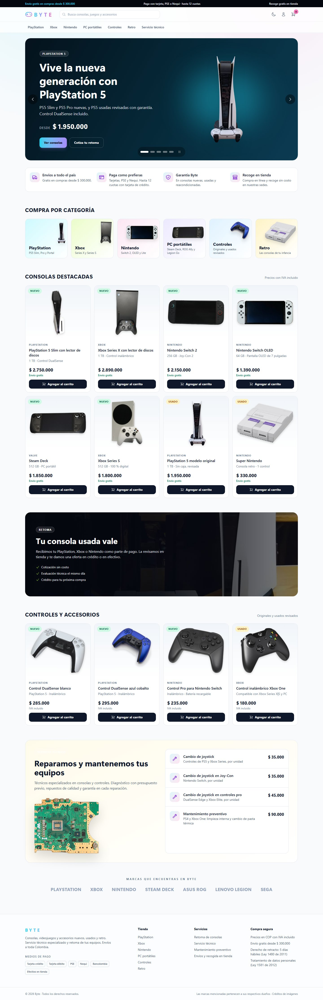

# Bitácora — Fase 1: Fundaciones

- **Fecha:** 2026-11-12
- **Rama:** `fase/01-fundaciones`
- **Objetivo:** dejar lista la base del proyecto (estructura, settings por entorno, Docker Compose, CI,
  `CLAUDE.md`, ADR iniciales y modelo de datos) sobre la que se construyen las fases siguientes.

## 1. Qué se hizo

| Entregable | Dónde |
|------------|-------|
| Reglas de trabajo, convenciones y comandos | [`CLAUDE.md`](../../CLAUDE.md) |
| 11 decisiones de arquitectura | [`docs/adr/`](../adr/README.md) |
| Modelo de datos (ER por dominio, estados del pedido y modelo estrella) | [`docs/modelo-datos.md`](../modelo-datos.md) |
| Proyecto Django 5.2 LTS con settings `base`, `dev`, `test` y `prod` | [`config/`](../../config/) |
| 21 apps con estructura en capas | [`apps/`](../../apps/) |
| Usuario propio por email con `public_id` UUID | [`apps/accounts/models.py`](../../apps/accounts/models.py) |
| Dinero e IVA, middleware de correlación y cabeceras, `/healthz`, errores | [`apps/core/`](../../apps/core/) |
| Layout gamer con modo oscuro y claro y páginas de error | [`templates/`](../../templates/), [`assets/css/input.css`](../../assets/css/input.css) |
| Inicio como tienda en línea: slider, categorías, destacados, controles, retoma, servicio técnico, marcas | [`apps/core/templates/core/home.html`](../../apps/core/templates/core/home.html), `apps/{cms,catalog,services_desk}/selectors.py` |
| 14 fotos reales de producto con licencia libre y página de créditos | [`scripts/product_images.py`](../../scripts/product_images.py), [`assets/img/productos.json`](../../assets/img/productos.json), `/creditos-imagenes/` |
| Docker multi-etapa y Compose (web, worker, beat, db, redis, tailwind) | [`Dockerfile`](../../Dockerfile), [`docker-compose.yml`](../../docker-compose.yml) |
| CI: lint → tests → seguridad → imagen con Trivy | [`.github/workflows/ci.yml`](../../.github/workflows/ci.yml) |
| Suite de tests: estructura, dinero, salud, errores, logs, cabeceras, settings y acceso | [`tests/`](../../tests/), `apps/*/tests/` |
| Scripts de evidencias y de librerías verificadas | [`scripts/`](../../scripts/) |

## 2. Cómo se hizo

1. **Versiones verificadas antes de fijarlas.** Se consultaron PyPI y npm el 12-nov-2026. Django
   6.1.3 es la versión más reciente, pero la LTS vigente es la 5.2.19, que es la que se eligió
   (ADR-0002). Los digests de las imágenes Docker, los SHA de las GitHub Actions y los checksums de
   Tailwind y de npm se obtuvieron de los registros oficiales.
2. **Lock reproducible con cuarentena.** `uv lock` con `exclude-newer = "7 days"` resolvió 185
   paquetes. Las versiones publicadas en los últimos 7 días quedaron fuera: el lock fijó gunicorn
   26.2.0 en lugar de la 27.0.1 publicada el día anterior, y psycopg 3.3.8 en lugar de la 3.3.9.
   `requirements/*.txt` se exporta con hashes para Docker.
3. **Esqueleto generado de forma uniforme.** Las 21 apps tienen los mismos archivos de capa.
   `tests/test_structure.py` impide que una app nueva rompa la convención y verifica que todos los
   módulos se importan sin errores.
4. **Seguridad desde la base.** La CSP con nonce, las cabeceras, las cookies `__Host-`, HSTS, Argon2,
   Celery con JSON, la API que deniega por defecto, el admin en ruta oculta, los logs enmascarados y
   los errores genéricos con ID de correlación se configuraron desde ahora, no al final.
5. **Frontend sin Node.** Tailwind 4 se compila con el binario standalone, descargado y verificado
   con SHA-256 por `scripts/vendor_assets.py`. htmx y Alpine en versión CSP se sirven desde
   `static/vendor/` y se verifican contra el sha512 de npm.
6. **Calidad continua.** Con cada bloque se ejecutaron ruff, black y mypy (estricto en `core` y
   `accounts`) y `manage.py check`.

### Correcciones del usuario durante la fase

| Indicación | Qué se hizo |
|------------|-------------|
| "Eso de estado del proyecto… no se hace en un entorno real" | Se eliminaron de la interfaz el bloque de fases y toda mención a fases, al proyecto académico o al "sandbox". El test `test_home_page_reads_like_a_real_store` evita que vuelvan. La convención quedó en `CLAUDE.md`. |
| Usar imágenes reales de consolas y accesorios | Se tomaron 14 fotos de Wikimedia Commons con licencia libre (dominio público, CC0, CC BY y CC BY-SA). Un script las fija por SHA-256, rechaza licencias no libres, quita el fondo de estudio y genera WebP sin EXIF. Se agregó una página de créditos con autor y licencia. |
| "El inicio tiene que mostrar las cualidades de la tienda… slider con consolas, accesorios, servicios, características" | Se rediseñó el inicio como tienda en línea completa: - barra de anuncios y slider accesible de 5 diapositivas; - beneficios y 6 categorías con foto; - 8 consolas y 4 controles con precio; - banner de retoma y servicio técnico con tarifas; - marcas y un pie de página con medios de pago y enlaces. |
| Lista de precios (Excel maestro y lista de respaldo) | Los precios del inicio salen de la lista maestra; la de respaldo cubre lo que falta. No se inventan descuentos "antes/ahora" (Ley 1480). Se excluyen las consolas "programadas" o "copia" y los servicios de chip, porque implican software sin licencia. |

### Problemas encontrados y cómo se resolvieron

| Problema | Solución |
|----------|----------|
| El heredoc de Git Bash falló al escribir los ADR | Se generaron con un script de Python, con una sola aprobación |
| `django-tailwind-cli` descarga el binario de Tailwind **sin verificar su checksum** | Descarga automática deshabilitada: `scripts/vendor_assets.py` lo descarga y verifica contra `sha256sums.txt` |
| Advertencia `django_tailwind_cli.W001`: la fuente CSS estaba dentro de `static/` y rompería `collectstatic` con manifest | Se movió a `assets/css/input.css` |
| mypy no encontraba el paquete `apps` (faltaba `apps/__init__.py`) | Se agregaron los `__init__.py` y se ajustaron los tipos de `UserManager`, `LOGGING` y `STORAGES` |
| `prod.py` y `dev.py` modificaban *en el mismo objeto* los dicts importados de `base.py`; importar los settings de producción en un test alteraba la CSP del entorno de pruebas | Ahora se hace `copy.deepcopy` antes de modificar. Un test vigila que no haya fugas entre entornos |
| Tailwind 4 no admite `group` dentro de `@apply` | `group` se puso en el HTML de las tarjetas |
| Las capturas de página completa no mostraban las imágenes con `loading="lazy"` | `capturas.py` recorre la página antes de capturar |
| La foto libre del PS5 Slim es pequeña (304 px) y se pixelaba en el slider | Se usa solo en la tarjeta del producto. El slider y la categoría usan una foto de alta resolución |
| Los degradados del fondo se repetían y dejaban "costuras" horizontales | `background-repeat: no-repeat` |
| Las capturas en PNG pesaban 7,3 MB | Se cambiaron a JPEG de calidad 85 |
| La imagen dev habría incluido semgrep (más de 100 MB) | `requirements/dev.txt` excluye el grupo `security`. Semgrep corre en el CI y, en local, en Docker con imagen fijada |

### Hallazgos de la verificación con Docker (cierre de la fase)

Docker no arrancaba porque faltaba **WSL2**. Al instalarlo y validar la imagen y el stack completo
aparecieron cinco problemas reales que no se veían sin contenedores:

| Hallazgo | Cómo se detectó | Corrección |
|----------|-----------------|------------|
| **Los estáticos eran ilegibles en producción.** `FILE_UPLOAD_PERMISSIONS = 0o640` también se aplicaba a `collectstatic` (ejecutado como root), y el usuario `byte` no podía leer `staticfiles/`. La tienda habría quedado sin CSS ni imágenes. | `docker run … ls staticfiles` → *Permission denied* | El storage de estáticos usa permisos propios (644/755). Los archivos subidos por usuarios siguen en 640/750. Test de regresión `test_static_files_are_readable_by_the_runtime_user`. |
| **La imagen de producción incluía las herramientas de seguridad** (semgrep 276 MB, bandit, pip-audit), lo que amplía la superficie de ataque (A03). `uv export --no-dev` solo excluía el grupo `dev`. | `du` sobre `/opt/venv` en la imagen | La exportación de producción usa `--no-default-groups`. La imagen pasó de **978 MB a 472 MB**. CI y `CLAUDE.md` actualizados. |
| **Semgrep: uso de SHA-1** para verificar las fotos de producto (no es resistente a colisiones). | `semgrep p/python` (1 hallazgo bloqueante) | Cada foto se fija ahora por **SHA-256**, calculado al bloquearla. El SHA-1 de Commons queda solo como dato informativo. Semgrep: 0 hallazgos. |
| **Trivy: 2 CVE HIGH en `zlib1g`** de la imagen base de Debian (CVE-2026-76844 y CVE-2026-85091), ambas con parche publicado; la imagen oficial aún no estaba reconstruida. | Trivy fijado por digest, igual que en el CI | La etapa base aplica las actualizaciones de seguridad de Debian. Trivy: 0 HIGH/CRITICAL corregibles. |
| **El worker de Celery no registraba la ejecución de tareas** (A09), porque Celery reemplazaba la configuración de logging de Django. | Se envió `core.ping` por Valkey: se procesó, pero no dejó rastro en el log | Receptor `setup_logging` en `config/celery.py` que aplica el `LOGGING` de Django. Ahora quedan en JSON "ready", "received" y "succeeded". |
| `bandit B310` (severidad media) por `urlopen` en los scripts de descarga | `bandit -ll` | Ya solo aceptaban `https://`. La llamada se aisló en `_open_https()` con la justificación documentada (`# nosec B310`). |
| `scripts/evidencia.py` fallaba al imprimir "→" en la consola de Windows (cp1252) | Ejecución local | Salida en UTF-8 para el script y los procesos que lanza. |

## 3. Por qué

- **Monolito modular con servicios** (ADR-0001): las reglas de negocio se prueban como funciones y se
  mantiene la transaccionalidad entre pedido y stock.
- **Django 5.2 LTS** (ADR-0002): soporte hasta 2028, que cubre todo el proyecto.
- **Permisos de objeto propios** (ADR-0003): el alcance es relacional (dueño o sede). Los querysets
  filtrados deniegan por defecto sin tablas de ACL que sincronizar.
- **Decimal con IVA incluido** (ADR-0004): lo exige la Ley 1480, y garantiza que la base más el IVA
  siempre sumen el bruto.
- **uv con hashes y cuarentena** (ADR-0005): mitiga OWASP A03 (cadena de suministro).
- **Sin Node y con Alpine CSP** (ADR-0006): CSP estricta y menos superficie de ataque.
- **Usuario por email y UUID públicos** (ADR-0011): evita IDOR y enumeración. Además, el modelo de
  usuario debe definirse antes de la primera migración.

## 4. Evidencias

Se generan con `uv run python scripts/evidencia.py --fase 1` y `uv run python scripts/capturas.py --fase 1`.
Cada verificación deja su salida en `docs/capturas/fase-01/NN-*.txt` y una imagen de terminal en
`NN-*.svg`. El resumen está en [`00-resumen.svg`](../capturas/fase-01/00-resumen.svg).

### Calidad y seguridad

| # | Verificación | Resultado |
|---|--------------|-----------|
| 01 | Tests (pytest) contra PostgreSQL 17 real | ✅ **323 pasan**, cobertura **99,83 %** (mínimo 80 %) |
| 02 | Linter (ruff) | ✅ sin hallazgos |
| 03 | Formato (black) | ✅ |
| 04 | Tipos (mypy, estricto en `core` y `accounts`) | ✅ 0 errores en 243 archivos |
| 05 | SAST bandit (severidad media o alta) | ✅ 0 hallazgos |
| 06 | pip-audit sobre `requirements/prod.txt` (con hashes) | ✅ sin vulnerabilidades conocidas |
| 07 | `manage.py check --deploy` con settings de producción | ✅ sin advertencias |
| 08 | Cabeceras de `GET /` (CSP con nonce, HSTS en prod, XFO, COOP, CORP, Permissions-Policy) | ✅ |
| 09 | Integridad de htmx, Alpine CSP y el binario de Tailwind | ✅ |
| 10 | SAST semgrep (`p/django` + `p/python`, 152 reglas, 235 archivos) | ✅ 0 hallazgos |
| 11 | Trivy sobre la imagen `byte:local` (HIGH/CRITICAL corregibles) | ✅ 0 |

### Infraestructura (Docker Desktop + WSL2)

- **Imagen de producción** (`docker build --target runtime`): 472 MB, corre como `uid=10001(byte)`,
  `/app` es de solo lectura para la app y los estáticos (comprimidos y con hash) son legibles.
- **`docker compose up --build`**:
  - web está *healthy* y aplicó todas las migraciones, incluida la de `pg_trgm` y `unaccent`;
  - PostgreSQL 17 y Valkey 8 están *healthy*, con los puertos publicados solo en `127.0.0.1`;
  - el worker de Celery 5.7 está *ready* y beat usa `DatabaseScheduler`;
  - el servicio Tailwind está en modo *watch*.
- **Circuito asíncrono:** Django → Valkey → worker. La tarea `core.ping` se encoló, el worker la
  procesó (`inspect stats`: `core.ping: 1`) y quedó registrada en JSON.
- **`/healthz`:** `{"status": "ok", "checks": {"database": "ok", "cache": "ok"}}`, HTTP 200
  ([captura](../capturas/fase-01/healthz-escritorio-oscuro.jpg)).

### Pantallas (Playwright, `DEBUG=False`)

| Pantalla | Escritorio oscuro | Escritorio claro | Móvil oscuro | Móvil claro |
|----------|-------------------|------------------|--------------|-------------|
| Inicio | [ver](../capturas/fase-01/inicio-escritorio-oscuro.jpg) | [ver](../capturas/fase-01/inicio-escritorio-claro.jpg) | [ver](../capturas/fase-01/inicio-movil-oscuro.jpg) | [ver](../capturas/fase-01/inicio-movil-claro.jpg) |
| Error 404 | [ver](../capturas/fase-01/error-404-escritorio-oscuro.jpg) | [ver](../capturas/fase-01/error-404-escritorio-claro.jpg) | [ver](../capturas/fase-01/error-404-movil-oscuro.jpg) | [ver](../capturas/fase-01/error-404-movil-claro.jpg) |

En la consola del navegador hubo **0 violaciones de CSP**
([reporte](../capturas/fase-01/consola-navegador-error-404-inicio.txt)). Los únicos mensajes son el
propio 404 de la página de error, que es lo esperado.

## 5. Pendientes y riesgos

- **Repositorio remoto:** el CI queda listo, pero se ejecuta cuando el proyecto se publique en GitHub.
- **Dependabot** no regenera `requirements/*.txt`. Por ahora se regeneran a mano (el CI detecta la
  desincronización); se evaluará automatizarlo en la Fase 8.
- **`django-ratelimit`** no tiene releases desde 2023; su compatibilidad se valida en la Fase 2.
- **CSP en el admin de Django 5.2:** el admin puede usar estilos inline. Se revisará en la Fase 2,
  junto con el MFA obligatorio del superadmin.
- **Escaneo de secretos** (gitleaks) en pre-commit y CI: se incorpora en la Fase 8.
