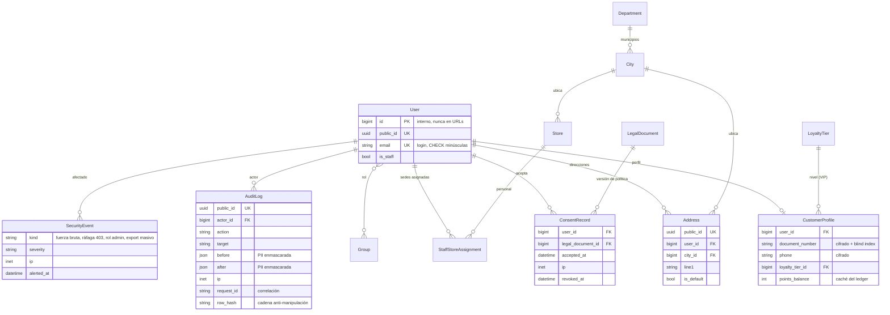
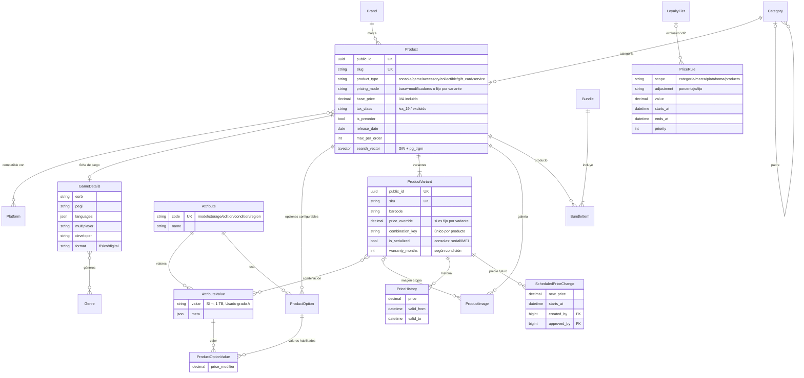
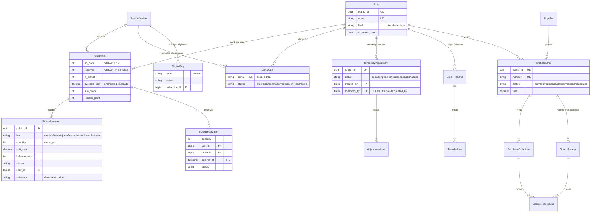
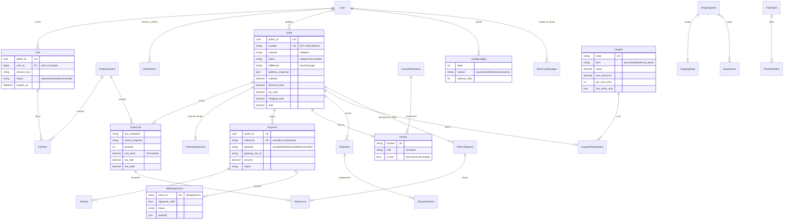
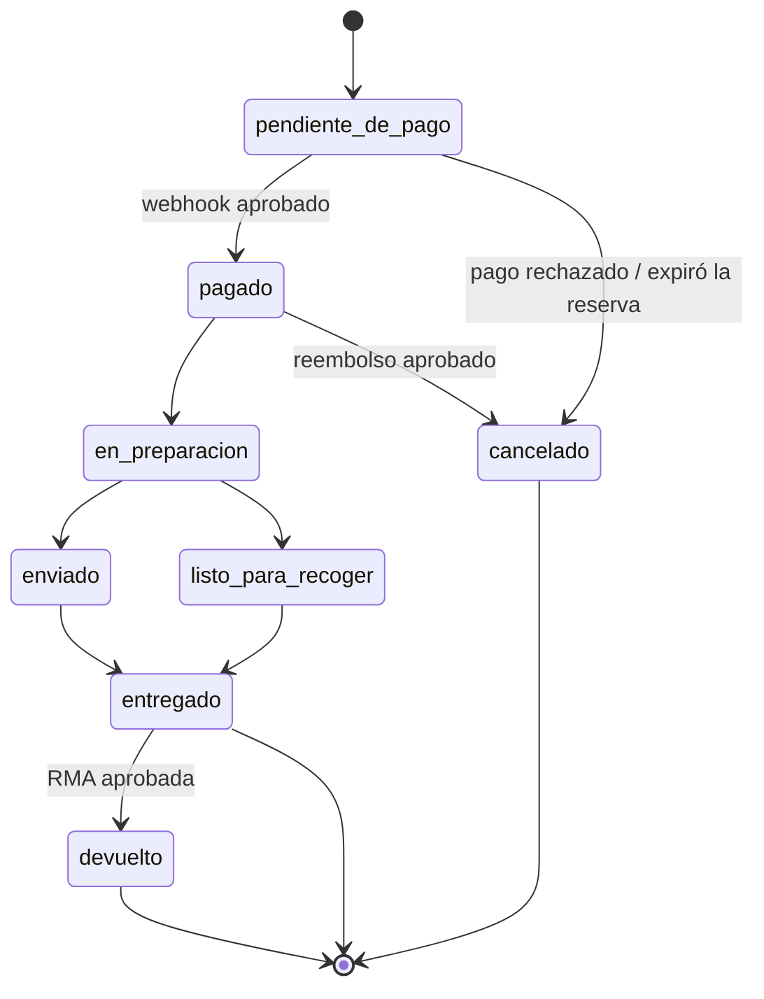
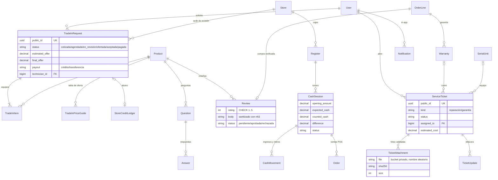
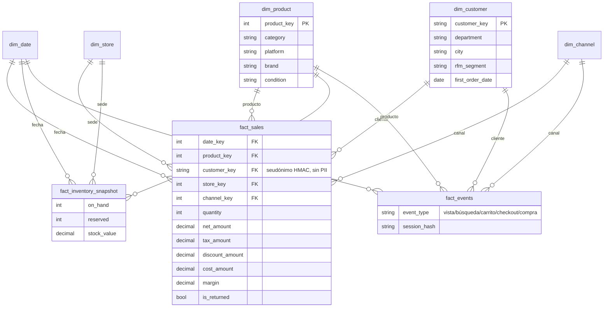

# Modelo de datos — Byte

Este documento describe el modelo de datos principal de Byte, organizado por dominio. Los diagramas
están en Mermaid; GitHub y la mayoría de editores los renderizan.

> **Estado:** en la Fase 1 se implementaron el usuario propio (`accounts.User`), los modelos base
> abstractos (`core.PublicIdModel`, `core.TimeStampedModel`) y las extensiones de PostgreSQL
> (`pg_trgm`, `unaccent`). El resto de entidades se implementa en la fase indicada en la tabla final.
> Los diagramas muestran solo los campos clave; el detalle completo vive en cada `models.py`.

## Reglas transversales

| Regla | Detalle | ADR |
|-------|---------|-----|
| Identificadores | La PK interna es `bigint` y nunca sale a URLs ni a la API. Hacia afuera solo se usa `public_id` (UUID4) o `slug`. | [0011](adr/0011-identificadores-publicos-y-usuario-email.md) |
| Usuario | El email es el login. Se guarda en minúsculas y un `CHECK` en la BD lo garantiza. No hay `username`. | [0011](adr/0011-identificadores-publicos-y-usuario-email.md) |
| Dinero | `Decimal(14,2)` en COP. Los precios **incluyen IVA**; el desglose base/IVA se hace por línea con `split_vat()`. Nunca se usa `float`. | [0004](adr/0004-dinero-decimal-e-iva-incluido.md) |
| Registros append-only | El kardex (`StockMovement`), los ledgers de puntos y de crédito, y `AuditLog` solo reciben inserciones. Las correcciones se hacen con movimientos inversos. | [0001](adr/0001-monolito-modular-con-servicios.md) |
| Snapshots | `Order` y `OrderLine` copian precio, nombre, SKU y dirección, así un pedido no cambia aunque cambie el catálogo. | — |
| Stock | Hay `CHECK (on_hand >= 0)` y `CHECK (reserved <= on_hand)`. Toda modificación va en `select_for_update()` dentro de `transaction.atomic()`. | — |
| Separación de funciones | `CHECK (approved_by <> created_by)` en ajustes de inventario, descuentos altos, reembolsos y órdenes de compra. | [0003](adr/0003-permisos-de-objeto-propios.md) |
| Datos sensibles | El documento, el teléfono y los códigos digitales se cifran en reposo (MultiFernet). Para buscar por documento se usa un *blind index* HMAC. | — |
| Analítica sin PII | El usuario se seudonimiza como `HMAC-SHA256(user_id, pepper)` en los eventos y en la capa Gold. | — |
| Supresión (Habeas Data) | Al anonimizar a un usuario se reemplaza su PII, pero los pedidos históricos se conservan con un snapshot anonimizado. | — |

## 1. Identidad, roles y auditoría

## 2. Catálogo y precios

El precio que cobra el servidor se resuelve en este orden:

1. Precio de la variante: fijo, o base + modificadores de cada opción.
2. `PriceRule` vigente (incluye los precios VIP).
3. `FlashSale`.
4. Cupón, aplicado en el checkout.

## 3. Inventario y compras

## 4. Venta: carrito, pedido, pago, envío y promociones

Estados del pedido (máquina de estados en `orders/services.py`):

## 5. Postventa y operación

Otros modelos sin diagrama:
- `cms`: `Banner`, `Page`, `NewsPost` y `LegalDocument`.
- `core`: `SiteConfiguration` (singleton con los datos de la empresa y la resolución DIAN simulada) e `IdempotencyKey`.
- `notifications`: `NotificationPreference` y `EmailTemplate`.

## 6. Analítica: capa Gold (Parquet + DuckDB)

La capa Gold no son tablas de Django sino archivos Parquet que se consultan con DuckDB (Fase 7).

En PostgreSQL viven los modelos operativos de la analítica:
- `Event`: usuario seudonimizado, índice BRIN en `occurred_at`.
- `PipelineRun` y `DataQualityCheck`.
- `ModelRun`: guarda las métricas MAPE, silhouette y precisión/recall.
- `ProductAssociation`: alimenta la sección "comprados juntos".
- `DemandForecast` y `ReorderSuggestion`.
- `CustomerScore`: RFM, churn y CLV, que se llevan al CRM.
- `Insight` y `SavedReport`.

## 7. Implementación por fase

| Fase | Entidades |
|------|-----------|
| 1 ✅ | `User`, `PublicIdModel`, `TimeStampedModel`, extensiones `pg_trgm` y `unaccent` |
| 2 | `CustomerProfile`, `Address`, `Department`, `City`, `ConsentRecord`, `LegalDocument`, `StaffStoreAssignment`, `Store` (base), `AuditLog`, `SecurityEvent` |
| 3 | `Platform`, `Brand`, `Category`, `Product`, `GameDetails`, `Genre`, `Attribute*`, `ProductOption*`, `ProductVariant`, `ProductImage`, `Bundle*`, `PriceRule`, `PriceHistory`, `ScheduledPriceChange` |
| 4 | `Cart*`, `WishlistItem`, `Order*`, `Payment`, `WebhookEvent`, `Refund`, `Invoice*`, `Shipping*`, `Shipment*`, `Coupon*`, `IdempotencyKey` y el núcleo del inventario (`StockItem`, `StockMovement`, `StockReservation`), porque el checkout reserva stock y debe probar que no hay sobreventa |
| 5 | `SerialUnit`, `DigitalKey`, `InventoryAdjustment*`, `StockTransfer*`, `Supplier`, `PurchaseOrder*`, `GoodsReceipt*`, `Register`, `CashSession`, `CashMovement`, `cms.*` |
| 6 | `TradeIn*`, `ServiceTicket*`, `Warranty`, `LoyaltyTier`, `LoyaltyLedger`, `StoreCreditLedger`, `FlashSale*`, `ReturnRequest*`, `Review`, `Question`, `Answer`, `Notification*` |
| 7 | `Event`, `PipelineRun`, `DataQualityCheck`, `ModelRun`, `ProductAssociation`, `DemandForecast`, `ReorderSuggestion`, `CustomerScore`, `Insight`, `SavedReport` y la capa Gold |
